<a href="https://macdaraomurchu.com/products/cornerman/">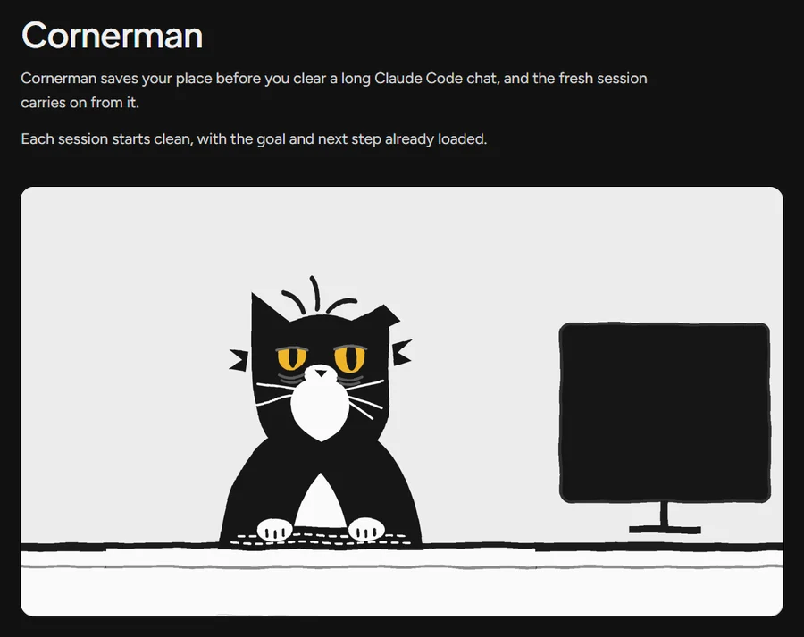</a>

<a href="https://marketplace.visualstudio.com/items?itemName=macdara.cornerman"></a> <a href="#install"></a> <a href="https://open-vsx.org/extension/macdara/cornerman"></a> <a href="https://github.com/m4cd4r4/cornerman/actions/workflows/test.yml"></a> <a href="LICENSE"></a>

[Product page](https://macdaraomurchu.com/products/cornerman/) · [Install](#install) · [Features](#features) · [Full guide](docs/GUIDE.md) · [Changelog](CHANGELOG.md)

Cornerman shows how full each Claude Code chat is, saves a handover before you clear it, and keeps the tables, lists, links and paths from the cleared chat one click away.

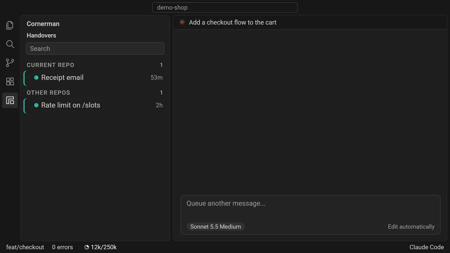

## Install

Plugin (in your terminal):

```
claude plugin marketplace add https://github.com/m4cd4r4/cornerman
claude plugin install cornerman@cornerman
```

You need Node 18 or later and git. On Windows, Claude Code runs plugin hooks through Git Bash, which comes with Git for Windows.

Extension: search "cornerman" in VS Code, or

```
code --install-extension macdara.cornerman
```

It is also on [Open VSX](https://open-vsx.org/extension/macdara/cornerman) for VSCodium and Cursor.

---

## Watch a handover run

The context fills, Claude saves a handover, and the fresh session carries on from it.

**1. Context fills**

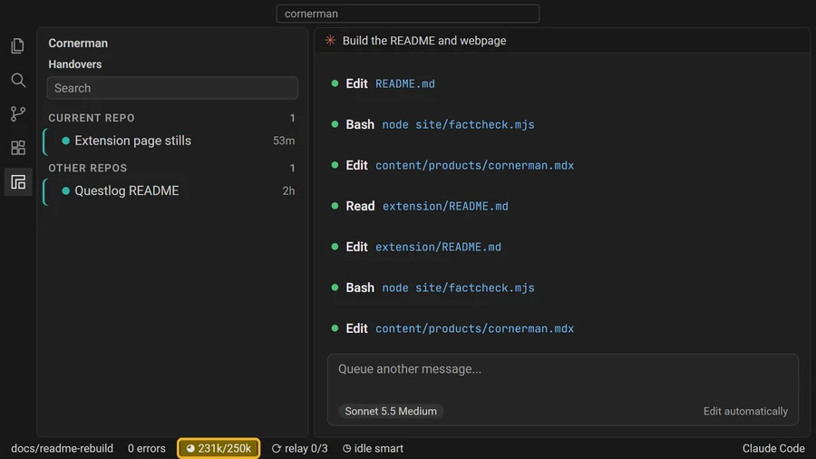

**2. Nudge (off by default)**

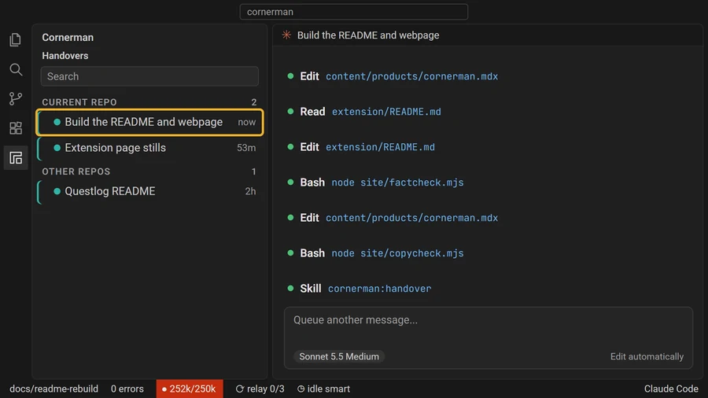

**3. Handover**

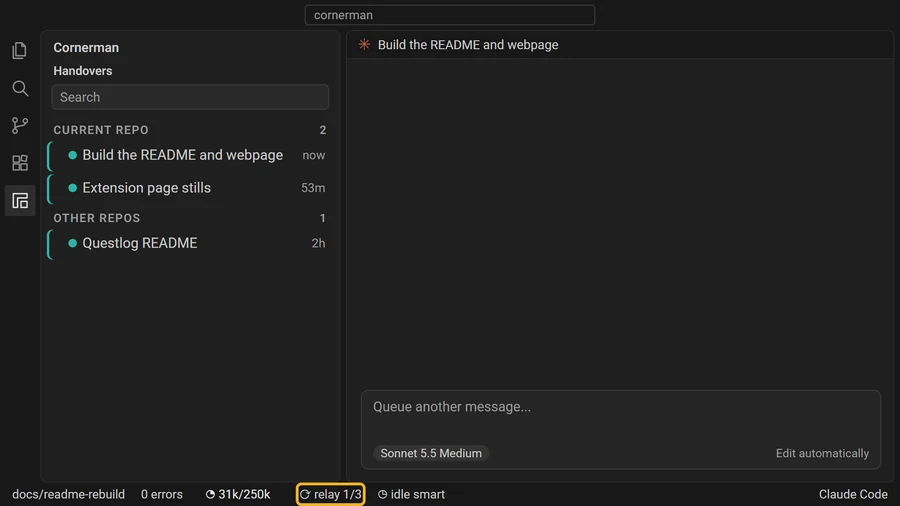

**4. Clear**

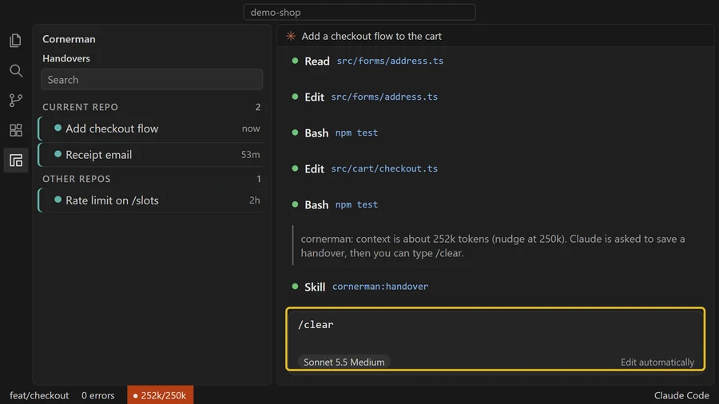

**5. Resume**

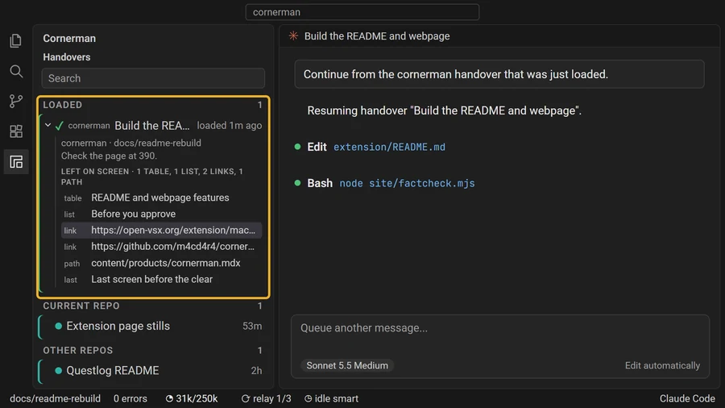

**6. Left on screen**

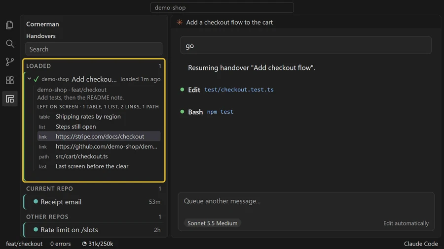

## Get back what was on screen

Tables, lists, links and paths from the cleared chat sit under each handover, one click away.

## Context counter

How full the chat is, filling towards the nudge size. Hover it to see which handover the tab loaded.

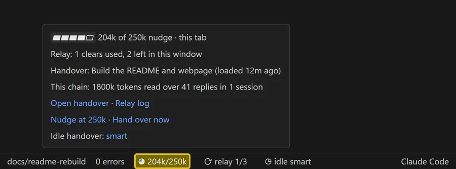

## Idle smart

What happens while you are away. Off, toast, smart or auto.

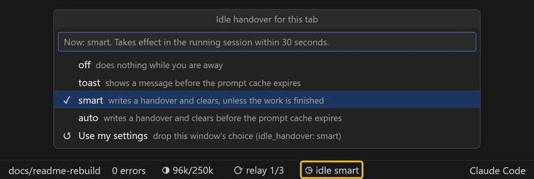

## Relay

The window's clears left. Click to change them.

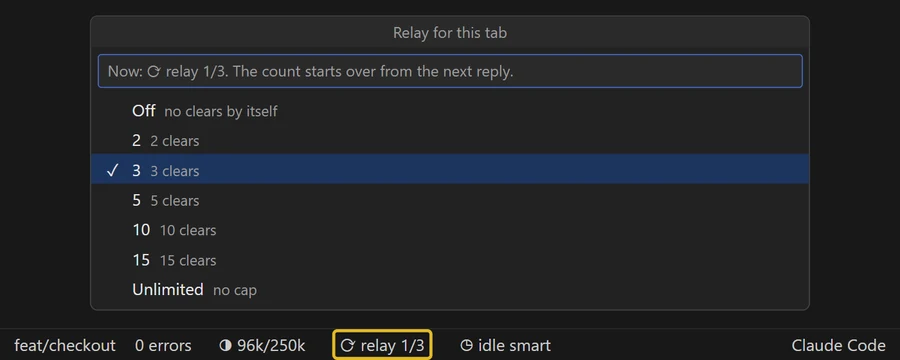

## Resume

Opens a Claude Code tab with the handover typed into the prompt box.

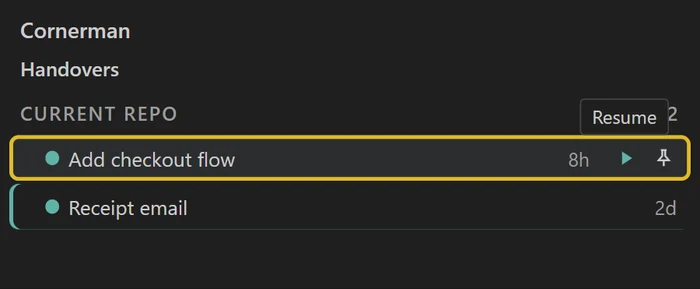

## Worktrees

Lists the repo's git worktrees and opens each in its own window.

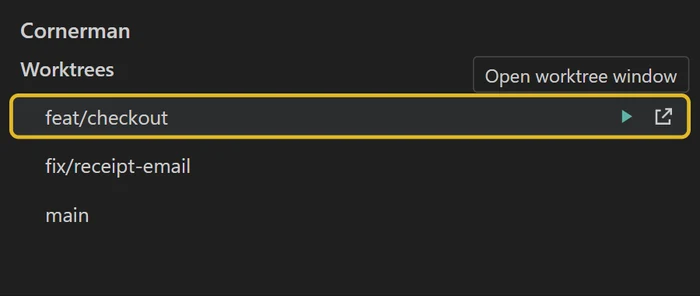

---

## Features

### In the VS Code footer

- **Context pie:** how full the chat is, filling towards the nudge size. Hover it to see which handover the tab loaded.
- **Relay:** the window's clears left. Click to change them.
- **Idle handover:** what happens while you are away. Off, toast, smart or auto.

### In the VS Code sidebar

- **Handovers** by repo: Loaded, Current repo, Other repos and Stale.
- **Resume** opens a Claude Code tab with the handover typed into the prompt box.
- **Pin** keeps a handover out of the Stale group.
- **Left on screen** under each handover: tables, lists, links, paths and the last screen.
- **Worktrees** lists the repo's git worktrees and opens each in its own window.

### In Claude Code

- `/cornerman:handover` saves a short note: the goal, the next action, where things stand, the decisions made and what already failed.
- The fresh session loads the note after `/clear`.
- **Nudge** (off by default): past a size you choose, Claude is asked to save a handover.
- **Relay** (off by default): it saves, clears and carries on, up to the number of clears you allow.
- Each handover belongs to the Claude Code window that wrote it.
- Handovers are plain text in `~/.cornerman`. Open them, change them or paste them into another chat.

---

[Full guide](docs/GUIDE.md) · [How it works](docs/HOW-IT-WORKS.md) · [Research](docs/RESEARCH.md)

<sub>MIT, see [LICENSE](LICENSE)</sub>
