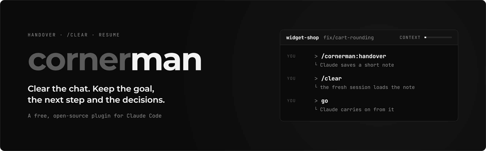
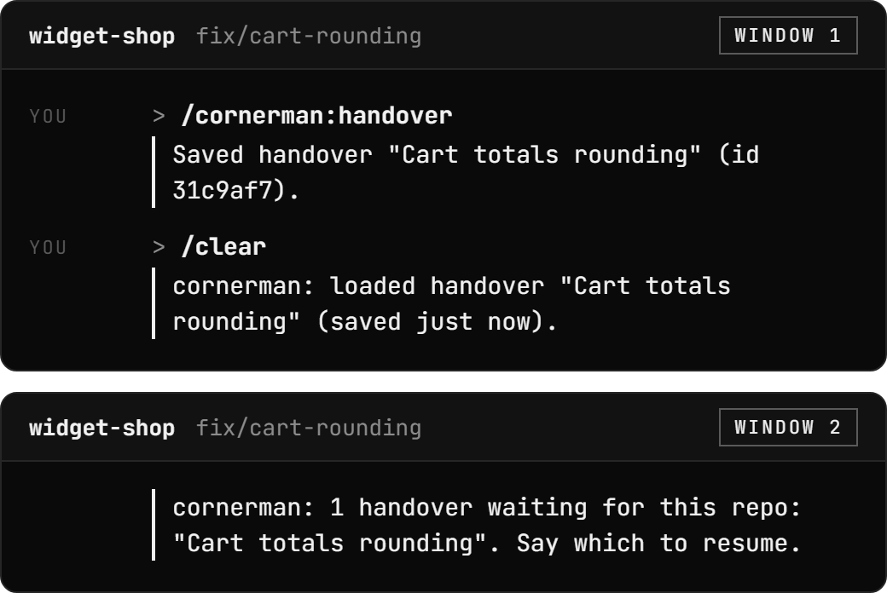
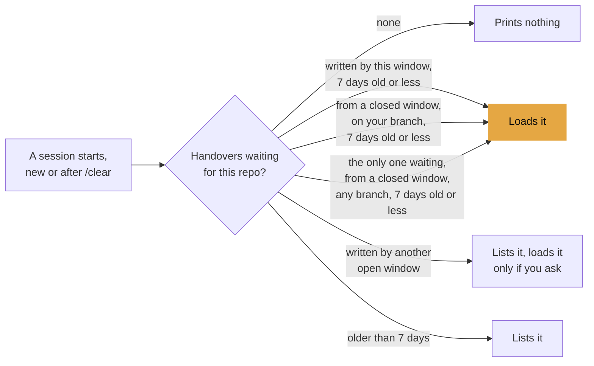
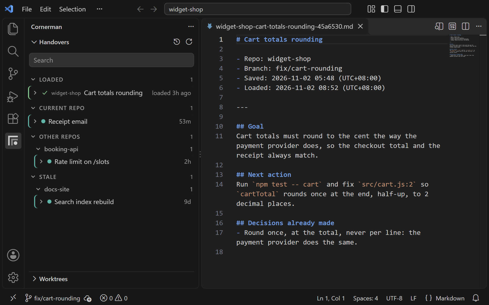
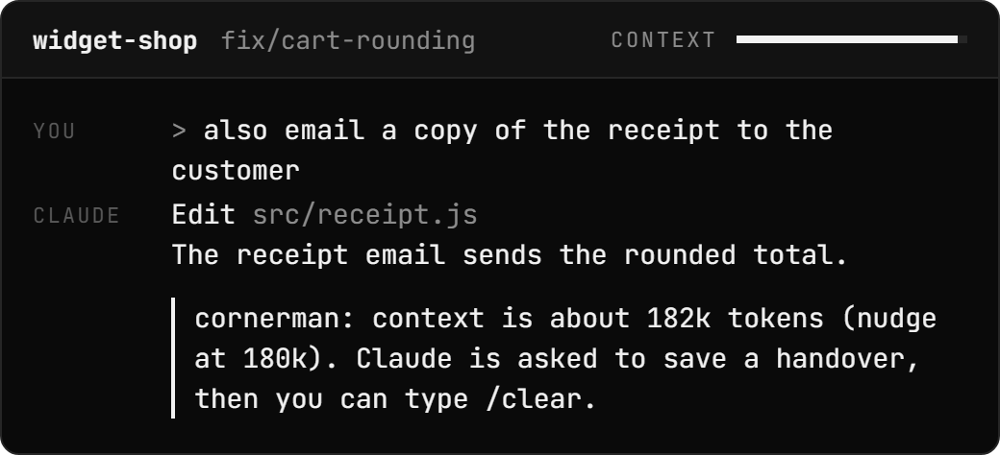
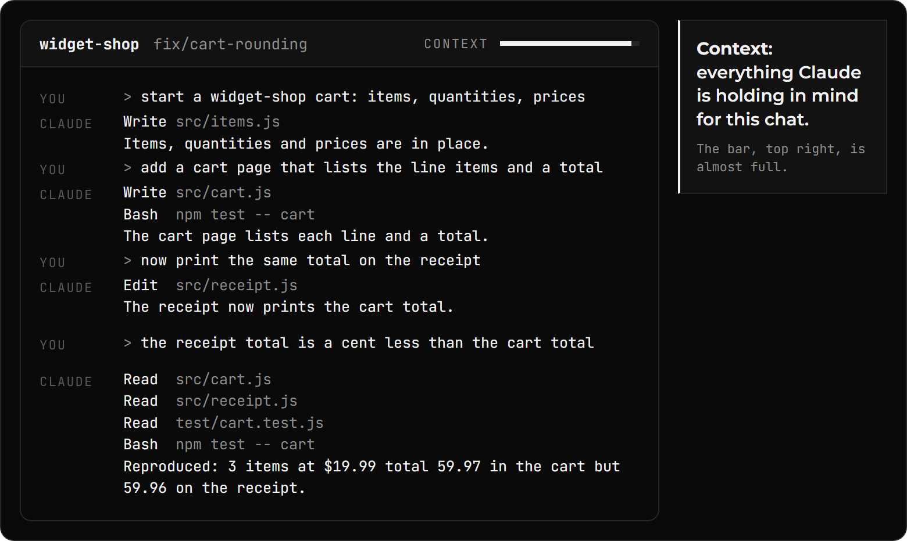

# Full guide

<p align="center">
  
</p>

<p align="center">
  <a href="../LICENSE"></a>
  <a href="https://github.com/m4cd4r4/cornerman/actions/workflows/test.yml"></a>
  
  <a href="https://m4cd4r4.github.io/cornerman"></a>
</p>

<p align="center"><b>Clear a long Claude Code chat without losing your place.</b><br>Claude writes a short note, you type <code>/clear</code>, and the fresh session carries on from it.</p>

<p align="center">
  
</p>

<p align="center"><sub>Watch the context bar, top right: full before <code>/clear</code>, almost empty after.</sub></p>

## What it does

- **Keeps your place across `/clear`.** One command saves a short note: the goal, the next action, where things stand, the decisions made and what already failed. The fresh session loads it and carries on.
- **Runs with nobody typing.** After your first prompt, it saves, clears and continues for you, up to the number of clears you allow.
- **A note you can read and edit.** It is a plain text file in `~/.cornerman`: open it, change it, paste it into another chat, or load it on a second machine with [sync](HOW-IT-WORKS.md#syncing-two-machines-optional).
- **Optional extras.** A [VS Code sidebar](#optional-a-vs-code-sidebar-and-a-nudge-when-the-chat-gets-long) lists your handovers by repo, and a footer shows how full the chat is.

## Install: two commands in your terminal

```bash
claude plugin marketplace add https://github.com/m4cd4r4/cornerman
claude plugin install cornerman@cornerman
```

> [!IMPORTANT]
> You need **Node 18 or later** and **git**. Claude Code's native installer does not add Node, so check with `node -v`. Without Node 18 on your PATH, the plugin shows one line saying so when a session starts, and does nothing else.
>
> On Windows, Claude Code runs plugin hooks through **Git Bash**, which comes with Git for Windows.

Claude Code then says, or asks about, seven options that are not set yet. They belong to the nudge, the relay and the idle handover, which are all on by default.

That is all the setup. When a chat grows long, Cornerman saves a handover, clears the chat and carries on by itself, up to 3 clears per window. [Change the number or turn it off](#pick-how-it-runs).

The author built it on Windows 11 and uses it there every day. On Linux, a clean install from GitHub was tested by hand on 5 Oct 2026: a session saved a handover and the next one loaded it and carried on. CI runs the tests on Windows, macOS and Linux; macOS has not been tested by hand yet.

<details>
<summary><b>Update</b></summary>
<br>

Plugins from a third-party marketplace do not update on their own by default. Run both lines, then restart Claude Code:

```bash
claude plugin marketplace update cornerman
claude plugin update cornerman@cornerman
```

</details>

<details>
<summary><b>Upgrade from clear-resume</b></summary>
<br>

This plugin used to be called clear-resume. Install it under the new name, then run the upgrade script **before** removing the old plugin, because removing it deletes its options:

```bash
claude plugin marketplace add https://github.com/m4cd4r4/cornerman
claude plugin install cornerman@cornerman
node ~/.claude/plugins/cache/cornerman/cornerman/0.7.0/scripts/upgrade.mjs
claude plugin uninstall clear-resume@clear-resume
claude plugin marketplace remove clear-resume
```

Then restart Claude Code. What happens to what you already have:

- **Handovers:** the next session start moves `~/.clear-resume` to `~/.cornerman` in one step and leaves a link at the old path. Nothing is removed. If a VS Code window has the folder open, your handovers stay where they are and keep working, and the move finishes once every VS Code window has been closed.
- **The link at `~/.clear-resume`:** leave it, or remove the link alone. On Windows use `cmd /c rmdir %USERPROFILE%\.clear-resume`: `Remove-Item -Recurse` follows the link and deletes your handovers.
- **Plugin options:** the upgrade script copies them to the new name.
- **`CLEAR_RESUME_` variables:** they keep working. A `CORNERMAN_` variable of the same name wins. The script lists the ones it finds.
- **Permission rules:** a rule like `Skill(clear-resume:handover)` does not carry over. The script lists them for you to change.
- **VS Code extension:** install the new one and uninstall the old one. Its settings are copied to the new names the first time it starts.
- **Two machines with sync:** upgrade both when you can. Nothing is lost while only one has, but until then the old machine marks old handovers as archived again and the two trade a commit at each sync.

</details>

<details>
<summary><b>Uninstall</b></summary>
<br>

```bash
claude plugin uninstall cornerman@cornerman
claude plugin marketplace remove cornerman
```

Your handovers stay in `~/.cornerman` until you delete that folder. If you added any `CORNERMAN_` lines to `~/.claude/settings.json`, remove them too.

</details>

## Pick how it runs

> [!TIP]
> **Choose how many clears, or none.**
>
> ```bash
> claude plugin install cornerman@cornerman --config relay=10
> claude plugin install cornerman@cornerman --config relay=off
> ```
>
> The relay is a **Claude Code mod**: a small module, [plugin/hooks/relay.ts](../plugin/hooks/relay.ts), that runs inside Claude Code and types `/clear` and the next prompt for you.

| How you run it | What you do | Settings |
|:--|:--|:--|
| **Relay (the default)** | Nothing. It saves, clears and carries on, up to the number of clears you allow | `auto_nudge=true`, and `relay` set to a number or `unlimited` |
| Nudge | Claude saves a handover at the size you set. You type `/clear`, then `go` | `auto_nudge=true`, `relay=off` |
| Manual | `/cornerman:handover`, `/clear`, `go` | `auto_nudge=false`, `relay=off` |

With the relay on, Claude saves a handover when the chat passes a size you choose, the plugin runs `/clear` when the turn ends, and the fresh session carries on.

The relay stops, and says why, when it uses up its clears for that Claude Code window, or when two continued sessions in a row make no new commit (outside a git repo, only the count applies). When the task is finished, Claude ends without a handover, so there is nothing to continue. It needs Claude Code 2.1.275 or later, and works in a terminal and in the VS Code chat panel.

<details>
<summary><b>Relay controls, and picking the nudge size</b></summary>
<br>

To change it for one window only, type `/relay 5`, `/relay unlimited` or `/relay off`; a bare `/relay` says where the count is. The status line counts down the clears left. The VS Code panel has no status line, so there a short message shows the count after each clear.

**Idle handover (optional, on by default).** Coming back to a long chat after the prompt cache has expired costs one full rewrite of the context; a handover written while the cache is still warm costs about a tenth of that ([the measurements](RESEARCH.md#idle-handover-against-a-cold-return)). With `idle_handover` set to `toast`, a message appears in the status line (and as a short toast) about 5 minutes before the cache expires and stays until your next turn starts. With `auto`, Claude is asked to write the handover, the session is cleared, and the new session waits for you: it does not continue the work while you are away. With `smart`, the default, it works like `auto`, except that Claude may decline: if the work is finished and no step remains, it replies "Nothing to hand over.", nothing is saved, the session is not cleared, and a toast says so. It works with the relay off. It acts once per session, only in an interactive session, only when the context is at least `idle_min_tokens`, and never after the cache has already expired.

| Setting | Default | What it does |
|---|---|---|
| `idle_handover` | `smart` | `off`, `toast`, `smart` or `auto`. `smart` is `auto` where Claude may decline: if the work is finished and no step remains it replies "Nothing to hand over.", and nothing is saved or cleared. A wrong "finished" costs the cold rewrite you would have paid anyway; no work is lost. Whether the model declines correctly was not measured. |
| `cache_ttl_minutes` | `60` | Your prompt cache lifetime: 60 on a subscription. On an API key the default is 5 minutes (measured, n=1), or 60 with `ENABLE_PROMPT_CACHING_1H=1`. Set this to match. The mod acts 5 minutes before it (half of it, if shorter). `auto` needs 10 or more, else it acts as `toast`. |
| `idle_min_tokens` | `100000` | Below this context size a cold rewrite is cheap, so nothing happens. |

Running `claude -p` with nobody at the keyboard? The [headless runner](HOW-IT-WORKS.md#headless-runs-no-clear-at-all) does the same job: each segment ends at the nudge, and the next starts from its handover.

**Pick the nudge size for your setup.** The default, 250k tokens, is a setting the author chose from ongoing use and experimentation, not a research result ([why, and what was measured](RESEARCH.md#why-the-nudge-defaults-to-250k-tokens)). It leaves about 180k tokens between handovers, which the author found a good sweet spot. If your sessions start with a smaller context, set **Nudge at** lower to keep a similar gap (a larger start, a higher setting). The author uses a 1M-token context window. More testing of the best handover window is planned. On a 200k window, set **Nudge at** below the size where Claude Code compacts on its own, or compaction comes first. Either way, keep it well above the size your sessions start at (your rules, CLAUDE.md and tool schemas), or every fresh session is nudged almost at once.

To change it, use any one of these (new sessions pick it up; the range is 50000 to 1000000):

- `/plugin configure cornerman@cornerman`, or `/config`, then **Nudge at**
- `claude plugin install cornerman@cornerman --config nudge_at=150000`
- the `CORNERMAN_NUDGE_AT` environment variable, which wins over the option

</details>

## The manual way: one command before `/clear`


| Step | Type | What happens |
|:--|:--|:--|
| 1. **Save a handover.** | `/cornerman:handover` | Claude writes a short note. The plugin saves it. |
| 2. **Clear.** | `/clear` | The fresh session starts with the handover already loaded. |
| 3. **Carry on.** | `go`, or say what to do next | Claude carries on from the handover. |

Claude reads your branch, your changes and your last few commits. Then it writes a short note about the work, called a handover: the goal, the next action, where things stand, the decisions made and what already failed.

<details>
<summary><b>What the plugin prints at each step</b></summary>
<br>

After the save:

```text
Saved handover "Cart totals rounding" (id 31c9af7).
After /clear, the next session in ~/code/widget-shop loads it automatically.
```

After `/clear`, the plugin's load message reads:

```text
cornerman: loaded handover "Cart totals rounding" (saved just now).
A copy to read or share: ~/.cornerman/loaded/widget-shop-cart-totals-rounding-31c9af7.md
```

Claude Code puts `SessionStart:clear says:` in front of the first line. If you do not see the message, press <kbd>ctrl</kbd>+<kbd>o</kbd> to show it. The handover loads either way.

</details>

Use it when a chat has grown long and you want to `/clear`. The handover keeps the task. The chat history behind it can go. The plugin checks for a waiting handover when a session starts, after `/clear` and after compaction (when `/compact`, or Claude Code on its own, shrinks the chat). When nothing is waiting, it prints nothing.

> [!NOTE]
> Handovers are plain text files on your disk, in `~/.cornerman`. Nothing is sent anywhere unless you turn on [sync](HOW-IT-WORKS.md#syncing-two-machines-optional) (to your own private git remote) or [web mode](HOW-IT-WORKS.md#claude-code-on-the-web-opt-in) (for Claude Code on the web). Keep secrets out of them.

## Also built in, with no setup

<p align="center">
  
</p>

**Each handover belongs to the Claude Code window that wrote it.** While that window is open, it is the only one that loads the handover after `/clear`. Other windows on the same project list it when they start, and load it only if you ask. Once that window closes, a session on the same branch loads it. A handover older than 7 days is listed, not loaded.

<details>
<summary><b>Which handover loads when a session starts</b></summary>
<br>



These are the common cases. After compaction, only this window's own handover loads. The full order is in [Which handover loads](HOW-IT-WORKS.md#which-handover-loads).

</details>

<p align="center">
  
</p>

**A copy you can read.** Each loaded handover is also saved as markdown in `~/.cornerman/loaded/` for 30 days. Reread what a session started from, or @-mention it in another session.

## Optional: a VS Code sidebar and a nudge when the chat gets long

<p align="center">
  
</p>

**The VS Code sidebar** is a separate extension that needs the plugin. It lists your handovers by repo, with the ones loaded in the last 24 hours at the top. **Resume** opens a Claude Code tab with the handover already typed into the prompt box, where it waits for you to send it.

It also adds a context pie to the status bar, filling towards the nudge size (hover it to see which handover the tab loaded), and a relay item that shows the window's clears left and changes them with a click. A **Worktrees** view lists the repo's git worktrees and opens each in its own window. [Extension README](../extension/README.md)

Search for cornerman in the Extensions view, or run:

```bash
code --install-extension macdara.cornerman
```

It is on the [VS Code Marketplace](https://marketplace.visualstudio.com/items?itemName=macdara.cornerman), and on [Open VSX](https://open-vsx.org/extension/macdara/cornerman) for VSCodium, Cursor and others.

<p align="center">
  
</p>

**The nudge** (auto mode) is on by default. Past 250k tokens of context (the default; **Nudge at** changes it), the plugin asks Claude to save a handover, and prints a status line saying so. If a turn ends and Claude neither saved one nor replied "Nothing to hand over." or "Handover not yet: ...", it is asked again at that turn end, up to 3 asks in all. With the [relay](#pick-how-it-runs) off, you type `/clear` yourself.

<details>
<summary><b>Turn the nudge off</b></summary>
<br>

To turn it off, run this in Claude Code in a terminal and switch off **Nudge to save a handover**:

```
/plugin configure cornerman@cornerman
```

The same two settings are rows in `/config` in Claude Code 2.1.269 or later. If you use the Claude Code panel in VS Code, set them from a terminal instead:

```bash
claude plugin install cornerman@cornerman --config auto_nudge=false
```

If your model's context window is 200k tokens, set **Nudge at** below the size where Claude Code compacts on its own, or compaction comes first. If you turned the nudge on earlier with `CORNERMAN_AUTO` in `~/.claude/settings.json`, that line wins over these settings: delete it to use them. [Auto mode details](HOW-IT-WORKS.md#auto-mode-on-by-default)

</details>

## Why: in a long chat, the work gets buried

<p align="center">
  
</p>

Claude rereads the whole context for every reply. In a long chat, the goal and the decisions sit under every file read and test run since the chat began, and each reply is slower and uses more of your plan or budget. `/compact` shrinks it to Claude's own summary, which can leave things out. `/clear` empties it, and the next session starts knowing nothing.

<details>
<summary><b>How this compares with <code>/compact</code>, <code>--resume</code> and <code>/clear</code></b></summary>
<br>

| | Claude keeps | You lose | Chat size after |
|:--|:--|:--|:--|
| `/compact` | Its own summary of the chat | What the summary leaves out | Smaller |
| `--resume` | The whole chat | Nothing | Same as before |
| `/clear` | Nothing | Everything, including where you were | Empty |
| **cornerman** | **A short handover it wrote on purpose** | **The rest of the chat** | **Just the handover** |

</details>

## What the testing found

Everything is in [docs/RESEARCH.md](RESEARCH.md), with each number's n, model and date. The short version:

- **Coming back to an idle chat costs less.** Claude Code's prompt cache lasts 60 minutes on a subscription (5 minutes by default on an API key). After that, the first message back rewrites the whole context: US$1.56 on a 390k-token Sonnet 5.5 session, in each of 3 runs. A handover written while the cache was warm, plus a fresh session reading it, cost US$0.15 to US$0.17 in all (n=3, 10 Oct 2026). The saving exists only if you come back, and the fresh session continues from the note, not the full chat. The idle handover is on by default, so this needs no setting.
- **It does not make a whole build cheaper.** On a 30-item site build with Sonnet 5.5, the relay and Claude Code's own auto-compaction cost the same (US$9.08 against US$9.19, n=5 each) and each finished 5 of 6 runs. Use the plugin for the convenience, idle returns and switching models, not to cut the bill on one long session.
- **Switching models mid-task costs less.** Moving a 390k-token Sonnet 5.5 session to Opus cost US$3.13; a handover first, then a fresh Opus session, cost US$0.24, about 13x less (n=1, 8 Oct 2026).
- **A fresh session did not remember more than the full chat.** In recall tests the plugin's note never overtook the full context at any size from 50k to 450k tokens. The saved note keeps the plan and the rules; the recent-activity trail added to it recovers the last commands and files (17 of 17 questions on 6 sessions, tuned on those questions).
- **The 250k nudge size is a judgement,** not a result: [what supports it and what does not](RESEARCH.md#why-the-nudge-defaults-to-250k-tokens).

## Built with it: Spare Cycles

[Spare Cycles](https://github.com/m4cd4r4/spare-cycles) is a small mod I made for Claude Code. It reminds you to do a short task you pick, like 10 push-ups, on a timer, so you take the break while Claude is working. The clip shows it being built in one long session, with cornerman relaying the work across clears, then running in the status bar of the window it was built in.

https://github.com/user-attachments/assets/03a746bb-a202-4f61-b21e-2856cfedb128

<sub>The clip uses a 2-minute timer, sped up, so a reminder comes due on camera. The default is 45 minutes, and you can change it. The status bar is in the cornerman extension's next release. The Marketplace version, 0.4.1, does not have it yet.</sub>

## What's inside

- **One skill**, `/cornerman:handover`, that saves the handover.
- **Four hooks**: one loads a waiting handover at startup, `/clear` and compaction; two nudge when the chat gets long; one keeps what the session left on screen.
- **One Claude Code mod**, the relay, that runs `/clear` after a save and continues from the handover.
- **One store**, plain files in `~/.cornerman`, that the hooks and the VS Code extension read and write through the same code. [What's inside](HOW-IT-WORKS.md#whats-inside)

> [!TIP]
> **[How it works](HOW-IT-WORKS.md)** has the rest.
>
> | I want to | Read |
> |:--|:--|
> | See a whole handover | [What a handover looks like](HOW-IT-WORKS.md#what-a-handover-looks-like) |
> | Find out why a handover did not load | [Troubleshooting](HOW-IT-WORKS.md#troubleshooting-my-handover-did-not-load) |
> | Know which handover loads, and when | [Which handover loads](HOW-IT-WORKS.md#which-handover-loads) |
> | Change a setting | [Settings](HOW-IT-WORKS.md#settings) |
> | Use two machines | [Syncing two machines](HOW-IT-WORKS.md#syncing-two-machines-optional) |
> | Use Claude Code on the web | [Claude Code on the web](HOW-IT-WORKS.md#claude-code-on-the-web-opt-in) |
> | See what it costs, reads and writes | [Cost](HOW-IT-WORKS.md#cost) and [Privacy](HOW-IT-WORKS.md#privacy) |
> | See what it cannot do | [Limitations](HOW-IT-WORKS.md#limitations) |
> | See the parts and the code | [What's inside](HOW-IT-WORKS.md#whats-inside) |

---

<p align="center">
  <a href="../LICENSE">MIT licence</a>. cornerman is an independent project. It is not made or endorsed by Anthropic.
</p>
