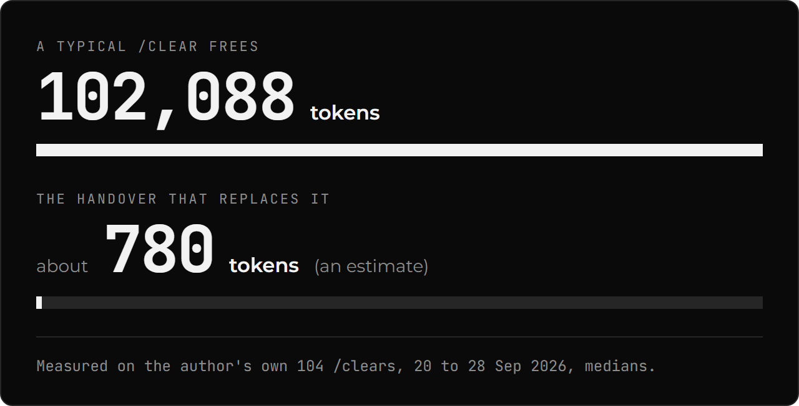

# Research: what was measured, what it showed, what it did not

clear-resume was tested before release. This page is the evidence behind the claims in the [README](../README.md): every result with its sample size (n), model and date, what each study cannot tell you, and the things that are a judgement rather than a measurement. Nothing here is needed to use the plugin.

**How to read the labels.** *Measured* means a run produced the number. *Modelled* means a fitted formula produced it. *Judgement* means the author chose it. Costs are API-equivalent (list price), because the runs used a subscription token. Prices changed between 9 and 10 Oct 2026, so only numbers from the same day compare.

**Where the raw data lives.** The run records, transcripts and harness are on the author's machine, not in this repo. The repo holds the designs and the two write-ups that were committed with predictions first: [idle end to end](research/idle-e2e/results.md) and the [CLAUDE.md trim test](research/claude-md-trim-test.md). The [results page](https://m4cd4r4.github.io/clear-resume/) charts the build runs. Predictions were written before each run and every one is reported, hit or miss.

## Summary

| Question | Answer | Status |
|:--|:--|:--|
| Does clearing early save money on a whole task? | No. Tied with auto-compaction; a session that never compacts used about 1.6x the tokens but cost about 6% more | Measured, n=3 to 6 |
| Does handing over before the cache expires save money on an idle return? | Yes, about 10x on one 390k session (US$1.56 against US$0.15 to 0.17) | Measured, n=3, one model |
| Does a fresh session with a handover work as well as the long chat? | For recall, no: the note never overtook the full context. For the next slice of work, it was as good and cost 0.14 to 0.83 of the long session | Measured, mixed |
| Is 250k the best nudge size? | Unknown. It is the author's choice, supported only by a cost model | Judgement and model |
| Does the prompt cache last 60 minutes? | On a subscription, yes. On an API key the default is 5 minutes | Measured, n=1 each |

## Why the nudge defaults to 250k tokens

**It is a judgement, not a result.** The author chose 250k from daily use. No published experiment compares a 250k nudge with a 180k one on cost or quality. An earlier changelog line said the A/B "found no cost benefit between 180k and 250k". That was wrong: every published relay arm used 180k, and the comparison was relay against auto-compaction against never compacting. The line has been corrected.

What does bear on the number:

- **A cost model (modelled).** Fitted from the 180k runs at three different starting sizes (22k, 46k and 68k tokens before the first message; n=3 per cell). It puts the cheapest nudge at about 160k plus 1.5 times your starting size. At the author's 66k starting size that is 267k, and 250k costs within 0.3% of it. The curve is flat above the optimum and steep below it, so setting it too high costs little and too low costs more. The model does not include quality, and its cell sizes are small.
- **The cost of going high (modelled, not measured).** A bigger context makes an idle return dearer: about US$1.00 at 250k against US$0.72 at 180k.
- **Recall at the two sizes (measured).** The full session answered 85% of questions at 180k (n=40) and 90% at 250k (n=42). It did not degrade at either, and its first drop was at 450k (54%, n=28, two transcripts). So the recall data does not favour one over the other.
- **Not measured.** A same-day 250k against 180k comparison on a whole build. Some 250k and 350k relay runs exist but were never written up with predictions, so they are not quoted here.

**What to do with this.** Keep your nudge size well above the size your sessions start at (your rules, CLAUDE.md and tool schemas), or every fresh session is nudged almost at once. If your sessions start small, the model says a lower setting is cheaper; if they start large, a higher one. More testing of the best handover size is planned.

## How big is a handover?

About 780 tokens in the handover, an estimate (its characters divided by 4). A typical `/clear` frees 102,088 tokens. Measured on the author's own 104 /clears, 20 to 28 Sep 2026, medians. 780 / 102,088 = 0.76%. The author's sessions start at about 77k to 99k tokens, so with a leaner setup a `/clear` at the same size frees more.

## Cost: relay against auto-compaction against one long session

A 30-item static-site build, scored by the plan's own checklist.

- **Sonnet 5.5, finished runs, list price:** relay US$9.08 (n=5), auto-compaction at about 177k US$9.19 (n=5), never compacting US$9.66 (n=3). The long session used about 1.6x the tokens (60.2M against 37.4M) but cost about 6% more, because the extra tokens are cheap cache reads.
- **Completion:** relay 5 of 6, auto-compaction 5 of 6, never compacting 3 of 3. An early "relay 3 of 3, compaction 2 of 3" did not hold up at n=6.
- **Opus 5.5:** relay 59.3M tokens and US$28.35 against 81.5M and US$29.06 for one plain session (n=1 each; the plain run reached 599k and never compacted). Over repeats, relay US$26.53 (n=4) against auto-compaction US$24.23 (n=3): compaction 7 to 9% cheaper.
- **Reading:** whole-task cost is a tie. The relay is not cheaper than auto-compaction, and the page never says it is.
- **Four shorter tasks** (a spec, a backlog, a suite): only the site build made enough large-context replies for a handover to matter. One pair's 1.31x token gap was run-to-run variance, not a saving.
- **A bigger starting size costs more (measured).** With the relay on Sonnet (n=3 each), an empty config cost US$12.21, trimmed rules US$15.76 and old rules US$17.89 (8 Oct price table), because a bigger floor eats the nudge budget. The prediction was "nearly flat"; it missed.

## Idle handover against a cold return

- **Cold return:** a 390,352-token Sonnet 5.5 session, left 65 minutes, cost US$1.56 on the first message back (n=3 on 10 Oct, same result at 180 minutes). The cache had lapsed, so the whole context was written again.
- **Handover written while warm, then a fresh session reads it:** US$0.15 to US$0.17 in all (n=3, 10 Oct). On 9 Oct the CLI priced cache reads twice as high and the same pair cost US$0.30 (n=1), about 5x. The gap is a price-table change, not noise.
- **At 263k tokens (idle end to end, n=1 per arm, 21 Oct):** the idle flow fired at 55.2 minutes, handed over, cleared and loaded in a fresh session for US$0.225 against US$1.024 for a cold return at list price. The CLI itself reported US$2.257 for the cold return, implying a cache-write price far above the table. That difference is unresolved, so by the CLI's figure the ratio is about ten to one and by list price about four to one.
- **One miss.** After the clear, "Go on." made the session answer "Holding off until you say to start" and write nothing. The handover had faithfully recorded "Do NOT start yet", because the chat said "not now". The same words proceeded in another arm. This is variance in how the note is read, not a fix, and a repeat at n=3 is proposed.
- **The `smart` mode,** one finished and one unfinished session: it declined correctly once and saved correctly once. One of each says nothing about accuracy.
- **Caveat.** The handover path continues from a note, not from the live chat. The saving only exists if you come back.

## Cache lifetime

- **Subscription token:** a 1-hour cache. Warm at 55 minutes, expired at 65 and 180.
- **API key, default:** a 5-minute cache only (n=1, Sonnet 5.5, Claude Code 2.1.296, 12 Oct). A write at 0, a read at +4, a rewrite after +6.
- **API key with `ENABLE_PROMPT_CACHING_1H=1`:** a 1-hour cache (n=1). Not tested: whether it survives exactly 60 minutes.
- **Consequence.** On an API key the window to hand over before the cache expires is about 5 minutes, not 60. Set `cache_ttl_minutes` to match.

## Model switch

Resuming a 392k-token Sonnet session on Opus cost US$3.13: one full rewrite on Opus. Writing a handover on the warm Sonnet session (US$0.20), then starting a fresh Opus session from it (US$0.04), cost US$0.24 in total, about 13x less (n=1, 8 Oct). The handover assumes a warm cache: written after expiry it re-cached 375k tokens for US$1.61.

## Recall: does a fresh session with a note remember as much?

Three never-compacting Sonnet 5.5 transcripts were cut at fixed sizes, with exact-match questions and no judge model (236 non-control questions per arm). Arm A kept the full context, arm B started fresh with the plugin's note, arm C used a manual `/compact`.

| Fill | A: full context | B: the plugin's note | C: `/compact` |
|:--|:--|:--|:--|
| 50k | 100% (n=14) | 57% | 14% |
| 100k | 91% (n=32) | 16% | 13% |
| 150k | 71% (n=38) | 18% | 8% |
| 180k | 85% (n=40) | 13% | 0% |
| 250k | 90% (n=42) | 10% | 0% |
| 350k | 88% (n=42) | 14% | 5% |
| 450k | 54% (n=28, 2 transcripts) | 7% | 0% |
| All | 82% (n=236) | 16% | 5% |

- **The note never overtook the full context at any size.** Compaction kept the task text and almost nothing else.
- **What the note lost was the tool history,** not the plan: it answered 0 of 102 questions about the last commands run, while plan status came back at 85% and task facts at 33%.
- **Where the full context fell,** it fell at 450k only (54%). The intervals are question-level and optimistic.
- **A trail fixed the gap.** Adding an exact, numbered list of recent files and commands raised the note to 92 to 93% overall. That was an oracle trail tuned on the same questions, so treat it as an upper bound; it is recall, not better work.
- **With tools on,** a session that can read the repo got plan status and task facts back from it alone (95% and 99%), but recalled none of the tool history (0 of 196). The note's unique value is the history.

## The recent trail (shipped)

Saving now appends the last files written, edited and read, the last commands that worked and the last that failed, read from the session's own transcript, not written by the model. On 6 real sessions (59 questions, Sonnet 5.5, 100k context, 16 Oct): a note without the trail answered 0 of 17 questions about the last commands, the full session 14 of 17, and the note with the trail 17 of 17; the other 42 questions were unchanged. Its wording was tuned on those same questions, so 59 of 59 is an upper bound. On 4 held-out sessions (38 questions) the production trail answered 37 of 38, the same as the full context, against 23 of 38 for a stand-in and 20 of 38 for a model-written trail.

## Does the work come out as good after a clear?

- **The next slice of work** (several builds, cuts from 100k to 454k): every run ticked every requested item, so the measure sat at the ceiling and could not show a gap. The fresh session cost 0.14 to 0.83 of the long one per slice, 0.48 at 450k (17 pairs, B cheaper in 15). That is the cost of the next slice, not of the whole task.
- **Rules given only in chat** (three rules): obeyed 11 of 12 with the note and in the long session, 1.75 of 12 with no note. Each arm lost the least visible rule in one run. A fresh session with a note keeps standing rules; without one it does not.
- **A bug hunt in an unseen repo** (5 reps): items found 8.0 in every arm; rules kept 2.8 of 3 with the note, 0.0 without; cost per run US$3.20 for the long session, US$0.90 for the note.
- **Page style,** 11 pairs: fresh builds jammed a heading against a list in 4 pairs against 0; the bar for a claim (p<0.10) was not met, and the claim was dropped.
- **Does the trail cut repeated work:** stopped when the API credit ran out; 13 of 36 planned pairs were valid and the primary claim was not met.
- **Caveat.** The long session resumed at 81 to 84% of its nominal size in some tests; the cause is unproven and it biases cost claims against the fresh session.

## Does a shorter CLAUDE.md change the work?

A 4.5k-token project file against a 2.0k-token trim (Sonnet 5.5, 4 tasks, 100 scored runs, 12 to 13 Oct). The first reply was about 2.7k tokens smaller. No rule the trimmed file kept was broken more often, but cost did not fall: one task cost about 29% more on the trimmed arm, because it read the moved reference file in 12 of 15 runs against 5 of 15. A 0-in-15 result still allows a failure rate near 18%. See the [write-up](research/claude-md-trim-test.md).

## What the literature says

A review of 35 verified sources (to 11 Oct 2026). The strongest:

- **Context rot is real but uneven.** Chroma's 18-model study (July 2025): quality falls as input grows, and one distractor hurts, four hurt more.
- **Older models fall hard** on synthetic long-context tests (NoLiMa, RULER); the numbers are from 2024 models.
- **A coding benchmark** (LongCodeBench, Claude 3.5 Sonnet): problems solved fell from 29% at 32K to 3% at 256K, while code Q&A stayed flat.
- **One 2026 test** of a current model, on 20 tasks with no intervals: 50%, 42.5% and 39.8% at 0k, 250k and 500k when the filler was related. Thin and not peer reviewed.
- **Multi-turn drift** (an average 39% drop) is about early wrong commitments, not length. It is not evidence that a longer chat is worse.
- **The gap.** No adequately powered, controlled comparison of full, compacted and cleared-with-handover exists for a current Claude model in a real tool session. This repo does not fill it either.

## Limits that apply to everything above

- **Small n.** One pair for the Opus cost test, 3 to 6 for Sonnet, 3 for idle, 1 for the cache and model-switch tests.
- **One model family and one build.** Sonnet 5.5 for nearly all quality work; one 30-item site build for cost. Shorter tasks showed no saving.
- **Recall is not work quality,** and the work tests sat at the ceiling, so they could not detect a small loss.
- **The replay is not the exact context.** The system prompt and tool schemas are not in a transcript.
- **Several fixes were tuned on the questions they were scored on,** so those numbers are upper bounds. Grader bugs were found after some results and are disclosed.
- **Price changes.** Compare within a day.

## Not measured

- A 250k nudge against a 180k one, on cost or quality.
- Whether the idle handover's saving holds on Opus, or at other sizes (the 180k and 250k figures are modelled).
- `smart` decline accuracy over a spread of sessions.
- Whether the 1-hour cache lasts exactly 60 minutes.
- Better work from a fresh session, as opposed to equal work at lower cost. No test has shown a gap in either direction.
